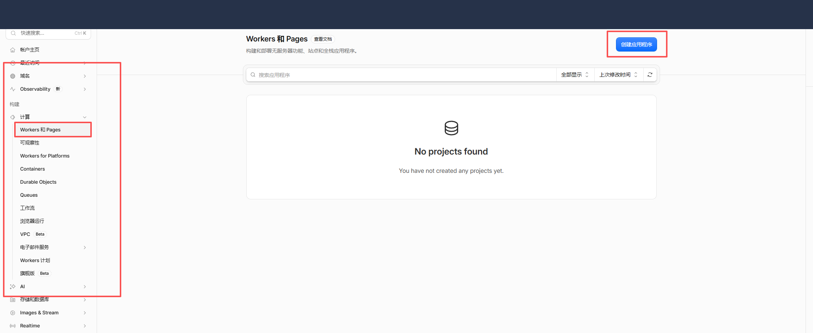
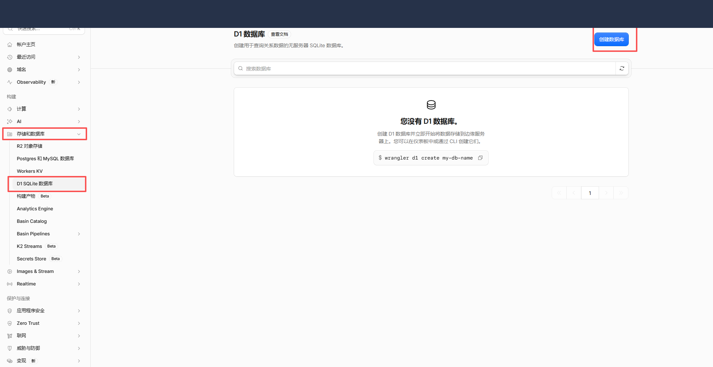
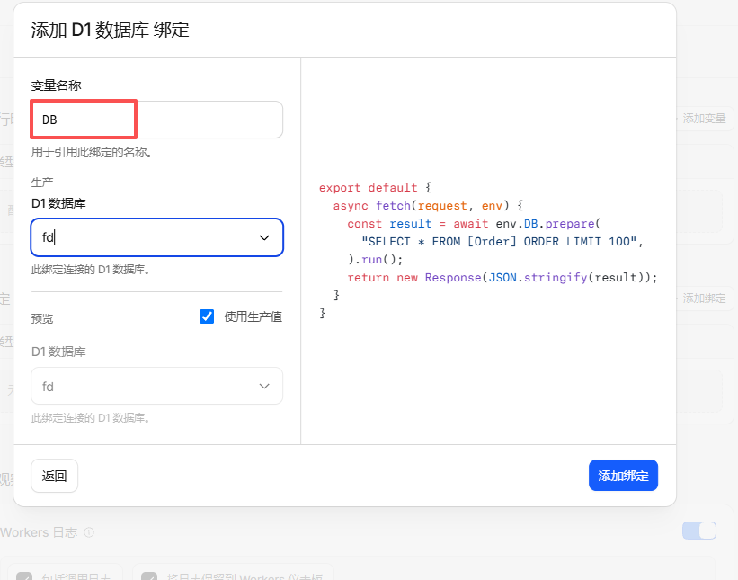
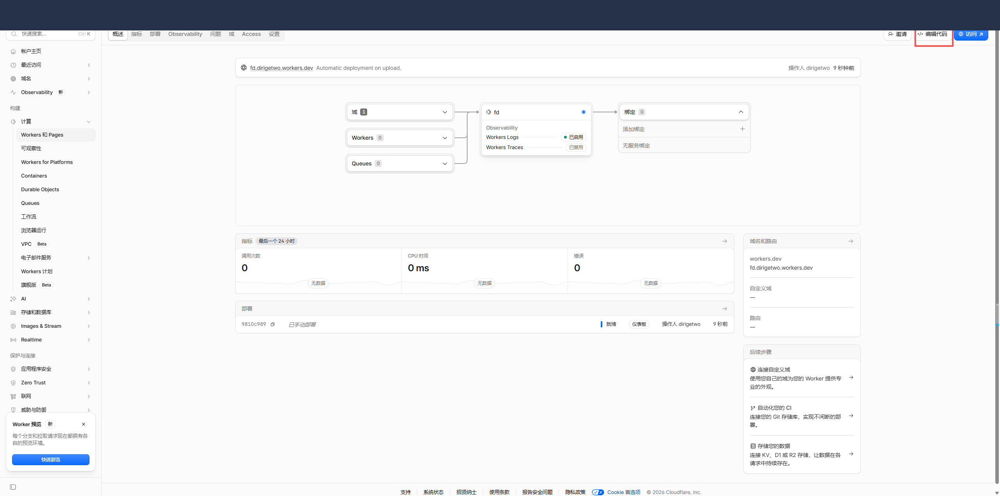
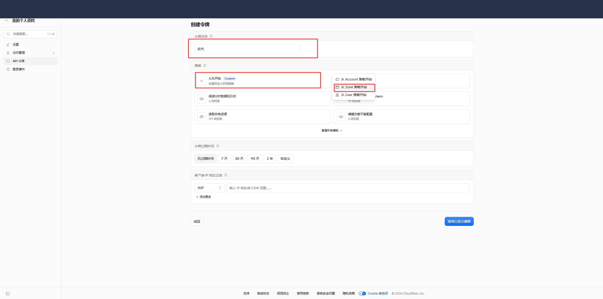
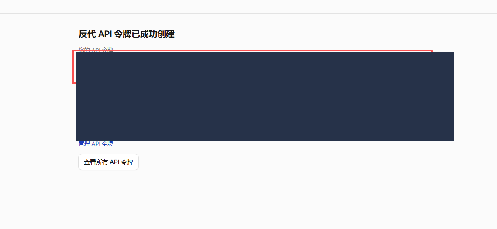
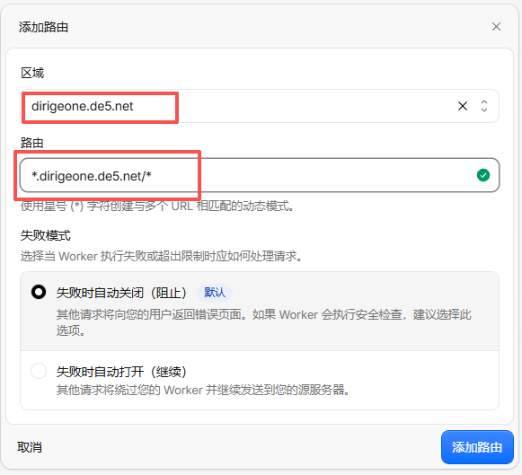
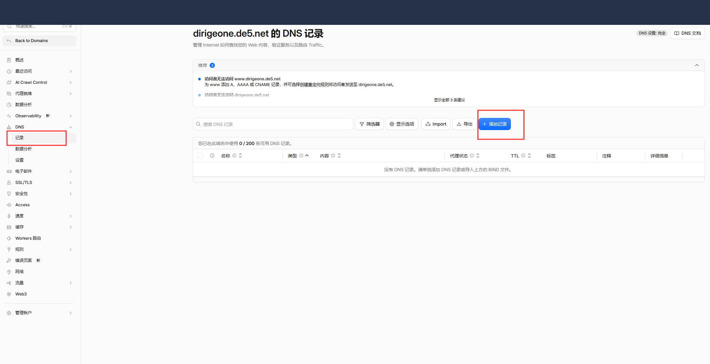

# 多人版部署教程：用户、邀请码、子域名与独立推流

更新：2026-11-25，适用 **`v6.8.11-multi-refactor.3`**。图示来自作者提供的部署稿，图片已本地化和脱敏。与个人版是两个独立发行版，**不要共用 D1、管理员根、通知密钥或中继秘密**。

完整注册／域名委派图文可参考 [个人版教程](个人版部署教程.md) 的第一至第三节；下面重点写多人版不同之处。已有服务先读 [UPGRADE.md](UPGRADE.md)，不从头重建数据库。

## 一、准备与域名规划

准备 Cloudflare 账号、有效域名和对应操作权限。假设已托管 `example.com`：

| 项目 | 本文示例 |
| --- | --- |
| Worker 名称 | `emby-multi`（可自定义） |
| 主入口 | `fd.example.com` |
| 用户域名后缀 | `example.com` |
| 用户 alice 入口 | `alice.example.com` |
| 多人版数据库 | 新建 `emby-multi-db`，不与个人版共用 |

用户名／子域名不能与系统保留名、主入口 `fd`、个人版 `proxy` 或其他业务记录冲突。多层子域名还要确认 TLS 证书覆盖范围，免费通配证书不自动覆盖无限层级。

## 二、创建 Worker 和独立 D1

Workers 和 Pages → 创建应用程序 → Hello World，名称填自己的多人版 Worker 名。

在 D1 控制台新建 `emby-multi-db`，然后回到该 Worker 添加 D1 绑定。

**变量名必须为 `DB`**，数据库选多人版库。首次请求自动做增量兼容初始化，不手工执行清库／重置 SQL。

## 三、粘贴最新多人版代码

打开仓库根目录 [worker.js](../worker.js)，点 **Raw** 复制完整内容。不要误选 `personal/worker.js`，也不要只粘贴 `src/multi.js` 的 import。

替换新建 Hello World 代码后保存部署。当前根目录 `worker.js` 是从 `src/`／`web/` 生成的最新多人版，旧回归基线已移到 `tests/baselines/`。

## 四、变量和 Secret

| 名称 | 类型 | 示例／说明 |
| --- | --- | --- |
| `ADMIN_TOKEN` | Secret | 独立强随机认证根；初始内置管理员密码 |
| `SESSION_SECRET` | Secret | 建议至少 32 随机字节；会话根，也可分用途派生 TG 加密密钥 |
| `BASE_DOMAIN` | 文本 | `fd.example.com`（完整主入口） |
| `DNS_RECORD_NAME` | 文本 | `fd` |
| `USER_DOMAIN` | 文本 | `example.com`，明确用户入口后缀 |
| `CF_API_TOKEN` | Secret | 自动 DNS／CF 统计需要；最小权限见下文 |
| `SETTINGS_ENCRYPTION_KEY` | Secret，可选 | 独立 32 随机字节 Base64；未设置时可从足够强的 SESSION_SECRET 派生 |
| `DISABLE_DIRECT_PROXY` | 文本 | `1`，不要开放任意 URL 转发 |

分别生成 `ADMIN_TOKEN` 和 `SESSION_SECRET`，不要共用。可在可信终端运行两次 `openssl rand -hex 32`；若用独立通知主密钥，再运行 `openssl rand -base64 32`。所有真实值只进入 Secret，不进仓库／截图。

兼容旧 `TELEGRAM_BOT_TOKEN`／`TELEGRAM_CHAT_ID`，但推荐管理员在网页保存。独立 `SETTINGS_ENCRYPTION_KEY` 格式错误时不会静默改用其它根，需修正。轮换 SESSION_SECRET 会影响全部用户会话和以它派生的 TG 密文，不能作为普通改密方法。

## 五、运行 API Token

只授权自己的区域：Zone → Zone → Read、Zone → DNS → Edit；需要统计再加 Zone → Analytics → Read，需要账户／Worker 统计再加 Account → Account Analytics → Read。

运行 Token 不需要 Workers Scripts → Edit；部署身份另行授权。创建成功页面的验证 curl 命令也含 Token，不能公开截图，示例已遮盖。

## 六、主入口与用户子域名接入

### 主入口

按作者的优选接入方案，给 `fd.example.com` 添加指向优选 IP／优选域名的记录时，**保持灰云（DNS only）**，并核对实际 Worker 域名／Route／TLS 承接。访问 `/health` 必须看到 `v6.8.11-multi-refactor.3`。若另选不使用优选的 Worker 自定义域，由 Cloudflare 管理 DNS 与 TLS，不与手工优选记录混用。

### 用户入口

为需要接入的用户 Host 配置 Workers Route，例如 `*.example.com/*` 指向多人版；更具体的 `proxy.example.com/*` 应继续指向独立个人版，其他已有业务也要显式排除，**不要盲目接管整个区域**。

Route 不自动创建 DNS，通配 Route 与通配 DNS 也不是同一个设置。**添加优选 IP／优选域名的用户记录仍须灰云**，不能因为有通配 Route 就改成橙云；优选接入本身还必须正确承接该用户的 Host 与证书。

**当前界面的自动用户 DNS／重新创建 DNS 功能会创建灰云记录**，这正是优选接入的预期行为，不需要“修正”为橙云：

- 使用优选记录时，保持灰云，验证其 Host 承接、证书和 Worker 匹配，不机械切换整站。
- 只有另行明确选择不使用优选的普通橙云 Route 方案时，才按 Cloudflare 官方要求配置被代理的 DNS；不要用该方案的要求覆盖灰云优选设置。
- 本项目不保证第三方优选域名长期可用；不要把“数据库里已有用户”当作“子域名与证书已经通了”。

验证 `https://alice.example.com/health`；它应显示同一个多人版版本。只检查 `fd.example.com/health` 不能证明用户入口正确。

## 七、管理员、邀请码与普通用户

1. 访问主入口 `/admin`，内置管理员用户名 `admin`（或留空），首次密码是 `ADMIN_TOKEN`。
2. 设置 → 安全，验证当前密码后设 12–128 字符新密码；只撤销当前账号会话。仍保留原认证根，不再接受它作为第二个网页密码。
3. 管理后台创建邀请码，设置用途、次数和到期时间。普通用户从 `/register` 注册；也可由管理员直接创建用户。
4. 视用户需要设置子域名、停用状态和线路配额。默认每用户 20 条，管理员界面可调整；普通用户不能访问管理员用户／通知设置接口。
5. 验证用户自己的 `/admin` 视图、线路列表和最终入口。用户名／子域名变化、管理员重置和停用需谨慎操作，不能拿真实用户做演示重置。

旧用户 PBKDF2 哈希、未改密旧会话和已有数据增量兼容；改密后按账号 epoch 撤销跨实例会话，其他用户不会一起退出。

## 八、线路与独立推流填写

- 目标：界面／API 服务基址，如 `https://api.example.net`；多行目标是同路径备用源站。
- 前缀：如 `demo`；用户 alice 的客户端服务器地址是 **`https://alice.example.com/demo`**。
- 推流地址（可选）：需匹配的独立媒体基址，如 `https://media.example.net`。不是“把播放路径拼到媒体域名上”，也不是备用 API 目标。
- 源站 302 跳向匹配推流域时，Worker 映射为同用户线路内的 `__stream/<编号>/...`；PlaybackInfo 的匹配绝对播放 URL 同样映射。保留路径、签名、重复 query、Range 和跨域凭据策略。
- 不匹配的链接不会随意改写；媒体源存储 `Path` 和相对 URL 不盲改。常规一体服可不填推流地址。

先用一条合规服务验证登录、真实起播、拖动、长播、字幕和 206；不要用虚构影片请求或公共信息接口 200 宣称播放通过。

## 九、VPS、TG 与 Cron

多人版沿用**全局中继开关**，没有个人版每条线路的自动／开／关三模式。地址／密钥缺失或全局关闭时，不会接入 VPS，也不会自动借用个人版中继。

如需中继，先按 [relay/README.md](../relay/README.md) 安全安装，再在管理员设置中保存自己的地址和密钥，测试健康并启用。GET/HEAD 安全回退和白名单 POST 边界见 [自动回退说明](AUTO-RELAY-FAILOVER.md)；独立推流映射保持同用户 VPS 偏好。

TG 在管理员设置 → 通知中保存／测试／停用，普通用户无权修改。密文在独立 `multi_private`，不导出 Token；清除或解密失败不回退旧机器人。Bot 只做通知，不接管 webhook。

按需启用健康检查、日报和告警，再在 Cloudflare 配置 Cron，示例 `*/10 * * * *`（UTC）。日报判断为北京时间 23 点，须覆盖 UTC 15 点；已有部署保留原 Cron，不照示例强改。

## 十、统计、升级与日志

- 用户统计仅汇总明确匹配的用户 Host；缺维度、未匹配或查询达到上限时显示不可用，不能回退账户总量伪装成该用户流量。
- 升级前备份完整 D1、原 Worker 版本、所有绑定／Secrets、域名、Cron 和智能放置；后台导出不含完整账号／私有配置，不能替代数据库备份。
- 保留原表、用户 ID、user_id、未知历史字段和索引；不为上线重建用户／邀请码／DNS，不激活历史孤立 `admin_routes`。
- 回滚代码不自动回滚密码／会话／TG；用户已改密或保存通知时先评估旧版忽略新机制的影响。见 [升级与回滚](UPGRADE.md)。
- 反馈故障请给入口、`/health` 版本、时区、播放器和同次 PlaybackInfo／媒体请求日志。删除 Token、Cookie、用户名、媒体签名和敏感目标，不公开完整用户日志。

## 十一、离线阅读

[单文件多人版 HTML](offline/multi.html) 可保存后双击阅读，图片和样式内嵌。Markdown 版请连 `assets/deploy/` 保存；参考个人版注册章节时也保存对应 Markdown。详细变量／权限／路由说明见 [DEPLOY.md](../DEPLOY.md)。
